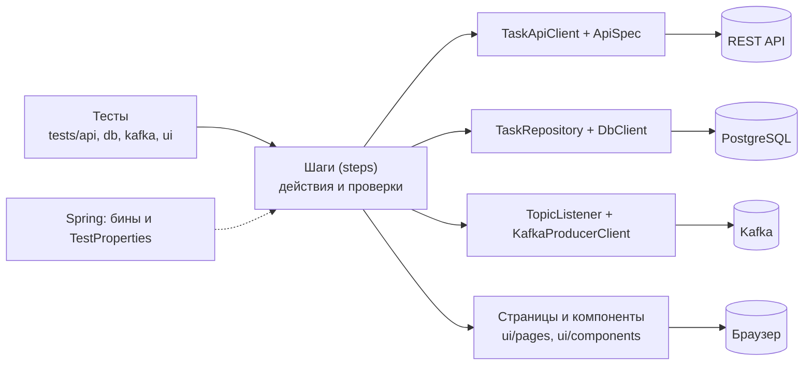
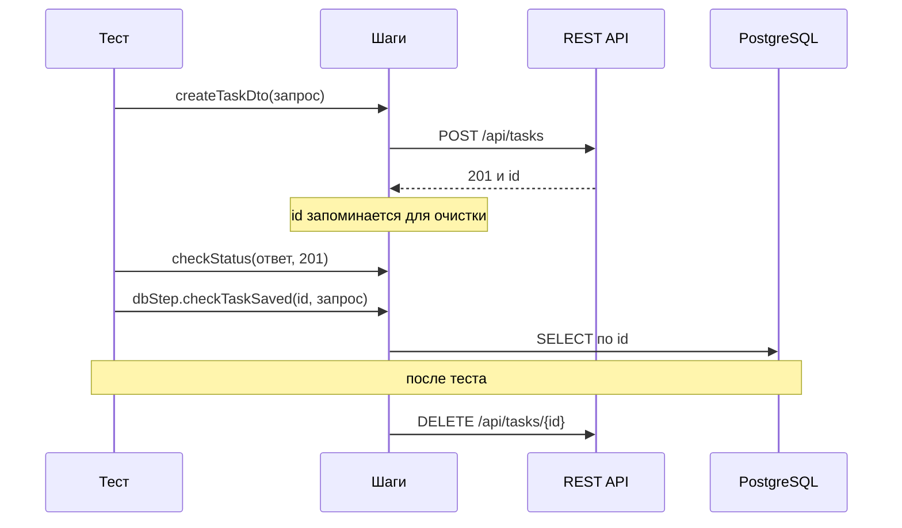

# task-api-tests

Автотесты для учебного сервиса [task-api-service](https://github.com/ArtemKarDev/task-api-service): REST API, веб-интерфейс, база данных и интеграция с Kafka. Проект учебный: на нём отрабатываются приёмы построения тестового фреймворка, запуск на нескольких стендах и работа в CI.

## Оглавление

- [Что тестируем](#что-тестируем)
- [Стек](#стек)
- [Виды тестов и теги](#виды-тестов-и-теги)
- [Стенды](#стенды)
- [Быстрый старт](#быстрый-старт)
- [Настройки](#настройки)
    - [Выбор стенда](#выбор-стенда)
    - [Как переопределить значение](#как-переопределить-значение)
    - [Список настроек](#список-настроек)
    - [Секреты](#секреты)
    - [Как узнать, откуда пришло значение](#как-узнать-откуда-пришло-значение)
- [Структура проекта](#структура-проекта)
  - [Слои](#слои)
  - [Дерево папок](#дерево-папок)
  - [Правила](#правила)
  - [Куда что добавлять](#куда-что-добавлять)
- [Как писать тест](#как-писать-тест)
  - [Жизнь одного теста](#жизнь-одного-теста)
  - [Скелет API-теста](#скелет-api-теста)
  - [Данные и шаги](#данные-и-шаги)
  - [Параметризованные тесты](#параметризованные-тесты)
  - [Тесты Kafka](#тесты-kafka)
  - [UI-тесты](#ui-тесты)
  - [Чек-лист нового теста](#чек-лист-нового-теста)

---

## Что тестируем

Сервис управления задачами (`Task`: название, описание, статус, приоритет, исполнитель):

| Часть сервиса | Что проверяем |
|---|---|
| REST API `/api/tasks` | создание, чтение, полная и частичная правка, удаление, формат ошибок, валидация |
| Веб-страницы (Thymeleaf) | поиск, создание и удаление задач, навигация, валидация формы |
| PostgreSQL | данные после операций, граничные значения, очистка |
| Kafka | события `task_out`, команды `task_in`, отклонённые сообщения `task_in_dlq` |

<p align="right"><a href="#оглавление">↑ к оглавлению</a></p>

---

## Стек

Java 21, Maven, JUnit 5, Spring (контекст без веб-сервера: настройки и внедрение зависимостей), REST Assured, Selenide, `kafka-clients`, Awaitility, AssertJ, Allure, OpenAPI Generator (модели API генерируются из `src/test/resources/openapi`).

<p align="right"><a href="#оглавление">↑ к оглавлению</a></p>

---

## Виды тестов и теги

Запуск по тегам: параметр `-Dgroups=...`.

| Тег | Что это | Нужен ли стенд |
|---|---|---|
| `unit` | проверки конфигурации | нет |
| `api` | REST-тесты | да |
| `db` | проверки базы данных | да |
| `kafka` | события и команды Kafka | да |
| `ui` | тесты браузера (Selenide, Page Object) | да, и Chrome |
| `smoke` | быстрый набор «всё ли живо» (включает API, Kafka и UI) | да |
| `regression` | полный набор | да |
| `negative` | негативные сценарии (дополнительная метка) | да |

Теги можно комбинировать: `"-Dgroups=api | db"` (или), `"-Dgroups=api & smoke"` (и).

<p align="right"><a href="#оглавление">↑ к оглавлению</a></p>

---

## Стенды

У каждого стенда свои приложение, база данных и брокер Kafka.

| Стенд | Приложение | PostgreSQL | Kafka | Где работает приложение |
|---|---|---|---|---|
| `local` | 8080 | 5433 | 9092 | запускается из IDE, БД и Kafka в Docker |
| `dev` | 8180 | 5432 | 9192 | в Docker |
| `stage` | 8280 | 5434 | 9292 | в Docker |

Стенды поднимаются из репозитория сервиса (`docker compose --env-file env/<стенд>.env up -d`), подробности в его README.

<p align="right"><a href="#оглавление">↑ к оглавлению</a></p>

---

## Быстрый старт

Нужны: JDK 21, Maven 3.9+, Docker Desktop, Chrome (для UI-тестов).

1. Поднять стенд (например, `local`: из репозитория сервиса `docker compose --env-file env/local.env up -d postgres kafka`, затем запустить приложение из IDE).
2. Запустить тесты (PowerShell, параметры с `-D` берите в кавычки):

```powershell
# без стенда: проверки конфигурации
mvn test "-Dgroups=unit"

# API и БД на стенде local
mvn test "-Dgroups=api | db"

# быстрый набор на dev; пароль БД стенда передаётся переменной окружения
$env:TESTS_DB_PASSWORD = "<пароль>"
mvn test "-Dgroups=smoke" "-Denv=dev"
```

3. Открыть отчёт Allure:

```powershell
mvn allure:serve
```

Один тестовый класс: `mvn test "-Dtest=CreateTaskTests"`. Тесты без окна браузера: добавить `"-Dtests.browser.headless=true"`.

<p align="right"><a href="#оглавление">↑ к оглавлению</a></p>

---

## Настройки

Все настройки тестов описаны в `src/test/resources`: общие значения в `application.yml`, различия стендов в `application-local.yml`, `application-dev.yml`, `application-stage.yml`. Читает их Spring и складывает в объект `TestProperties`, который получают все классы тестов.

### Выбор стенда

Стенд выбирается параметром или переменной окружения (по умолчанию `local`):

```powershell
mvn test "-Denv=dev"            # параметр запуска
$env:TEST_ENV = "stage"         # или переменная окружения
```

Допустимы только `local`, `dev`, `stage`: при любом другом значении (например, опечатке) запуск останавливается с понятным сообщением, а не идёт молча на другой стенд.

### Как переопределить значение

Любую настройку можно задать, не меняя файлы. Источники, от самого важного к самому слабому:

1. параметр запуска `-Dtests.<имя>` (например, `"-Dtests.base-url=http://localhost:9000"`);
2. переменная окружения `TESTS_<ИМЯ>` (например, `$env:TESTS_BASEURL = "http://localhost:9000"`);
3. файл стенда `application-<стенд>.yml`;
4. общий файл `application.yml`.

Имя переменной окружения получается из имени настройки: убрать дефисы, заменить точки на подчёркивания, перевести в заглавные (`tests.kafka.bootstrap-servers` превращается в `TESTS_KAFKA_BOOTSTRAPSERVERS`).

### Список настроек

| Настройка | Переменная окружения | Что это | Значение по умолчанию (local) |
|---|---|---|---|
| `tests.base-url` | `TESTS_BASEURL` | адрес приложения | `http://localhost:8080` |
| `tests.db.url` | `TESTS_DB_URL` | адрес PostgreSQL | `jdbc:postgresql://localhost:5433/taskdb` |
| `tests.db.user` | `TESTS_DB_USER` | пользователь БД | `taskuser` |
| `tests.db.password` | `TESTS_DB_PASSWORD` | пароль БД | для `local` в `application-local.yml`, для `dev` и `stage` только из переменной окружения |
| `tests.browser.name` | `TESTS_BROWSER_NAME` | браузер | `chrome` |
| `tests.browser.headless` | `TESTS_BROWSER_HEADLESS` | без окна браузера | `false` |
| `tests.browser.size` | `TESTS_BROWSER_SIZE` | размер окна | `1920x1080` |
| `tests.browser.timeout-ms` | `TESTS_BROWSER_TIMEOUTMS` | сколько Selenide ждёт элемент, мс | `6000` |
| `tests.browser.remote-url` | `TESTS_BROWSER_REMOTEURL` | адрес удалённого Selenium (пусто: браузер запускается локально) | пусто |
| `tests.kafka.bootstrap-servers` | `TESTS_KAFKA_BOOTSTRAPSERVERS` | адрес брокера Kafka | `localhost:9092` |
| `tests.kafka.topic-in` | `TESTS_KAFKA_TOPICIN` | топик команд | `task_in` |
| `tests.kafka.topic-in-dlq` | `TESTS_KAFKA_TOPICINDLQ` | топик отклонённых сообщений | `task_in_dlq` |
| `tests.kafka.topic-out` | `TESTS_KAFKA_TOPICOUT` | топик событий | `task_out` |

### Секреты

Пароли в репозиторий не кладём. Для `dev` и `stage` пароль БД передаётся только переменной `TESTS_DB_PASSWORD` (на своём компьютере: `$env:TESTS_DB_PASSWORD = "..."`, в Jenkins: из хранилища Credentials). Исключение: пароль стенда `local` в `application-local.yml` учебный и совпадает с тем, что лежит в `compose.yaml` сервиса.

### Как узнать, откуда пришло значение

Если тест ходит не туда, куда ожидалось, запустите «детектор»: он печатает значение настройки и источник (файл со строкой, параметр или переменная окружения):

```powershell
mvn test "-Dtest=SpringSettingsTests" | Select-String "tests\."
```

<p align="right"><a href="#оглавление">↑ к оглавлению</a></p>

---

## Структура проекта

### Слои

Тест не обращается к клиентам, базе и браузеру напрямую: он вызывает **шаги**, а шаги работают с клиентами. За создание всех объектов и подачу настроек отвечает Spring.



### Дерево папок

```text
src/test/java/ru/learning/taskapitests
├── Tags.java              имена тегов JUnit
├── TestBase.java          общий родитель тестов: контекст Spring, шаги, очистка данных
├── client/                HTTP-клиент REST API (TaskApiClient)
├── specs/                 настройка запросов REST Assured (ApiSpec)
├── db/                    доступ к PostgreSQL (DbClient, TaskRepository, TaskDbRecord)
├── kafka/                 клиенты Kafka и модели сообщений
├── config/                настройки и рецепты Spring (TestProperties, TestsConfig, ProfileGuard)
├── data/                  фабрика тестовых данных (TaskDataFactory)
├── steps/                 шаги с @Step: действия и проверки
│   └── ui/                шаги для интерфейса
├── ui/                    Selenide: базовый класс UI-тестов, скриншоты при падении
│   ├── pages/             Page Object: страницы
│   └── components/        Page Object: шапка, форма, строка таблицы
├── utils/                 вспомогательное: JSON, вложения Allure
└── tests/                 сами тесты
    ├── api/   db/   kafka/   ui/   unit/

src/test/resources
├── application.yml, application-<стенд>.yml    настройки
├── allure.properties, junit-platform.properties
└── openapi/openapi-task-api-service.json       контракт API

jenkins/                   Jenkinsfile и скрипты запуска в Jenkins
pom.xml
```

Модели запросов и ответов REST API не написаны вручную: при сборке они генерируются из `openapi-task-api-service.json` в пакет `ru.learning.taskapitests.generated.model` (папка `target`, в репозитории её нет).

### Правила

1. **Тест вызывает шаги**, а не клиентов и репозитории напрямую.
2. **Проверки живут в тестах и шагах.** Page Object ничего не проверяет: он только находит элементы и выполняет действия.
3. **Каждый тест убирает за собой.** Задачи, созданные через шаги, удаляются автоматически после теста; названия делает `TaskDataFactory` уникальными.
4. **Настройки только через `props`** (`TestProperties`), а не строками в коде.
5. **Новый вспомогательный класс** помечается `@Component` и лежит в пакете, который просматривает Spring (`client`, `db`, `specs`, `steps`), иначе Spring его не найдёт.

### Куда что добавлять

| Что добавляем | Куда |
|---|---|
| Новый REST-тест | `tests/api`, класс наследует `TestBase` |
| Новая страница интерфейса | `ui/pages`, её части в `ui/components` |
| Новое действие или проверка | `steps` (или `steps/ui`), с аннотацией `@Step` |
| Новая настройка | `application.yml` и поле в `TestProperties` |
| Новая модель запроса или ответа | обновить `openapi-task-api-service.json`, модели сгенерируются |
| Новый топик Kafka | настройка в `application.yml`, метод в `KafkaSteps` |

<p align="right"><a href="#оглавление">↑ к оглавлению</a></p>

---

## Как писать тест

### Жизнь одного теста



Тест вызывает шаги, шаги работают с системами. Всё, что тест создал, удаляется автоматически после него.

### Скелет API-теста

Тестовый класс наследует `TestBase`: из него приходят готовые шаги (`step`, `dbStep`, `kafkaStep`), клиент (`taskApi`) и настройки (`props`). Пример:

```java
@Tag(Tags.API)
@Tag(Tags.REGRESSION)
@Epic("API")
@Feature("Создание задачи")
class CreateTaskExampleTests extends TestBase {

    @Test
    @DisplayName("Созданная задача сохраняется в БД без искажений")
    void shouldSaveCreatedTaskToDatabase() {
        var request = TaskDataFactory.defaultTaskRequestDTO();

        Response response = step.createTaskDto(request);

        step.checkStatus(response, 201);
        dbStep.checkTaskSaved(response.jsonPath().getLong("id"), request);
    }
}
```

Что значат аннотации:

| Аннотация | Для чего |
|---|---|
| `@Tag(Tags.API)` | вид теста: по нему тест попадает в запуск `-Dgroups=api` |
| `@Tag(Tags.REGRESSION)` | вхождение в полный набор; быстрые проверки дополнительно помечаются `@Tag(Tags.SMOKE)` |
| `@Epic`, `@Feature` | группировка в отчёте Allure |
| `@DisplayName` | читаемое название теста по-русски: оно видно в отчёте |

### Данные и шаги

**Данные.** Запросы собирает `TaskDataFactory`: `defaultTaskRequestDTO()` даёт корректный запрос с уникальным названием, `customTaskRequestDTO(...)` позволяет изменить нужные поля, есть генераторы строк заданной длины для граничных значений. Прямые строки с названиями не пишем: уникальность нужна, чтобы тесты не мешали друг другу.

**Шаги.** Основные (полный список смотрите в классах):

| Класс | Что делает |
|---|---|
| `TaskSteps` | запросы к REST API (создать, получить, изменить, удалить) и проверки ответов и формата ошибок |
| `DbSteps` | проверки записей и счётчиков в базе данных |
| `KafkaSteps` | отправка команд, чтение событий, проверка отклонённых сообщений |
| `TaskUiSteps`, `NavigationUiSteps` | действия и проверки в браузере |

**Очистка.** Когда шаг создаёт задачу (ответ 201), её номер попадает в список для очистки, а после теста `TestBase` удаляет все такие задачи через API. Если вы создали задачу в обход шагов (например, прямым запросом), добавьте её вручную: `step.registerTaskForCleanup(id)`.

### Параметризованные тесты

Одинаковый сценарий на нескольких значениях пишется через JUnit-параметры:

```java
@ParameterizedTest(name = "приоритет {0}")
@EnumSource(CreateTaskRequest.PriorityEnum.class)
@DisplayName("Задача создаётся с любым допустимым приоритетом")
void shouldCreateTaskWithEachPriority(CreateTaskRequest.PriorityEnum priority) {
    var request = TaskDataFactory.customTaskRequestDTO(r -> r.priority(priority));

    step.checkStatus(step.createTaskDto(request), 201);
}
```

Для списков значений используют `@CsvSource`, для сложных данных `@MethodSource`. Название `name = "..."` подставляет значение параметра в отчёт.

### Тесты Kafka

Главное правило: **слушатель запускается до действия**, которое должно вызвать событие. Иначе событие придёт раньше, чем мы начали слушать, и тест его не увидит.

```java
var listener = kafkaStep.startListening(props.kafka().topicOut());
var response = step.createTaskDto(request);          // действие порождает событие
// дальше шаги ждут событие (до 20 секунд) и проверяют его содержимое
```

Отправка команды и чтение отклонённых сообщений устроены так же; готовые методы лежат в `KafkaSteps`.

### UI-тесты

UI-тесты наследуют `UiTestBase` (он настраивает Selenide, подключает отчёт Allure и закрывает браузер). Страницы описаны Page Object'ами в `ui/pages` и `ui/components`, действия и проверки собраны в шагах `uiStep` и `navStep`:

```java
var request = TaskDataFactory.defaultTaskRequestDTO();
long taskId = uiStep.createTaskViaUi(navStep.openCreateTaskPage(), request);
dbStep.checkTaskSaved(taskId, request);
```

Page Object ничего не проверяет: он только находит элементы и выполняет действия. Проверки делают шаги или тест. При падении теста скриншот и исходник страницы прикладываются к отчёту автоматически.

### Чек-лист нового теста

- [ ] класс наследует `TestBase` (или `UiTestBase` для интерфейса) и лежит в `tests/<вид>`;
- [ ] есть теги вида и набора (`@Tag(Tags.API)`, `@Tag(Tags.REGRESSION)`), при необходимости `SMOKE`;
- [ ] есть `@Epic`, `@Feature` и русский `@DisplayName`;
- [ ] данные берутся из `TaskDataFactory`, названия уникальные;
- [ ] тест вызывает шаги, а не клиентов напрямую;
- [ ] созданное через шаги удаляется автоматически, созданное в обход шагов зарегистрировано для очистки;
- [ ] для Kafka слушатель запущен до действия;
- [ ] тест проходит локально и не зависит от порядка запуска.

<p align="right"><a href="#оглавление">↑ к оглавлению</a></p>

