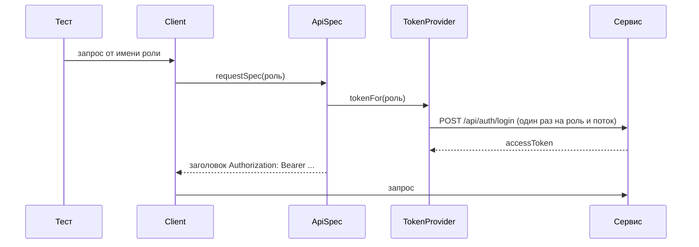
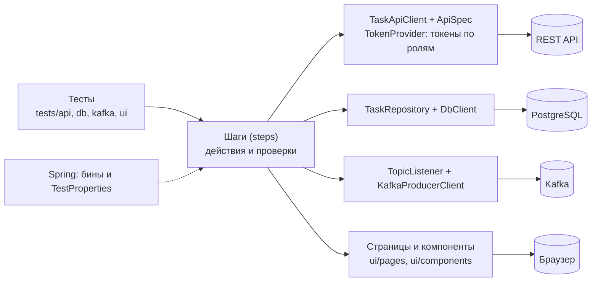
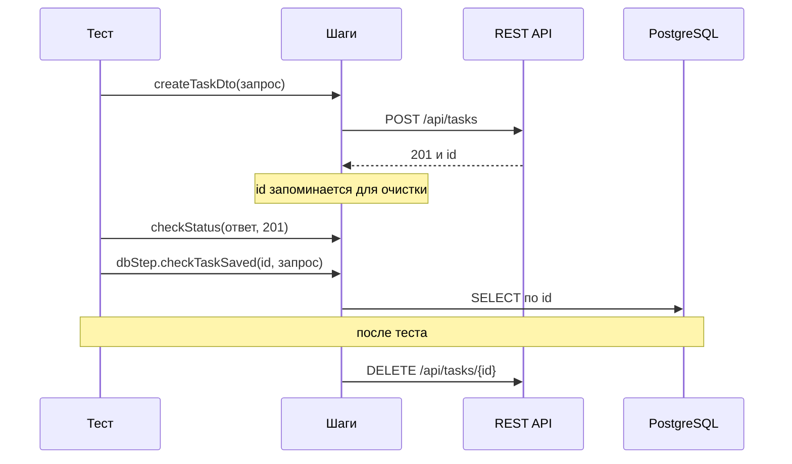
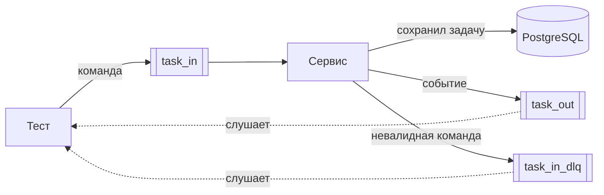
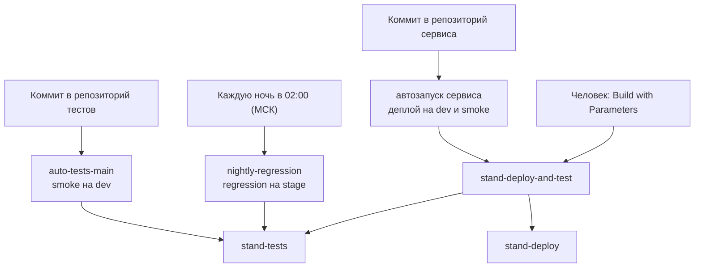
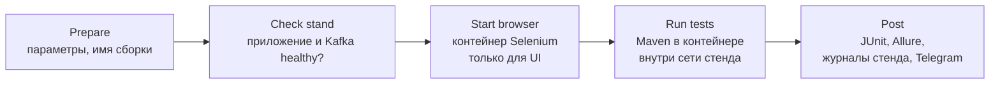

# task-api-tests

Автотесты для учебного сервиса [task-api-service](https://github.com/ArtemKarDev/task-api-service): REST API, веб-интерфейс, база данных и интеграция с Kafka. Проект учебный: на нём отрабатываются приёмы построения тестового фреймворка, запуск на нескольких стендах и работа в CI.

## Оглавление

- [Что тестируем](#что-тестируем)
- [Стек](#стек)
- [Виды тестов и теги](#виды-тестов-и-теги)
- [Стенды](#стенды)
- [Быстрый старт](#быстрый-старт)
- [Настройки](#настройки)
  - [Выбор стенда](#выбор-стенда)
  - [Как переопределить значение](#как-переопределить-значение)
  - [Список настроек](#список-настроек)
  - [Секреты](#секреты)
  - [Как узнать, откуда пришло значение](#как-узнать-откуда-пришло-значение)
- [Авторизация в тестах](#авторизация-в-тестах)
  - [Роли и учётные записи](#роли-и-учётные-записи)
  - [Вход в API-тестах](#вход-в-api-тестах)
  - [Вход в UI-тестах](#вход-в-ui-тестах)
- [Структура проекта](#структура-проекта)
  - [Слои](#слои)
  - [Дерево папок](#дерево-папок)
  - [Правила](#правила)
  - [Куда что добавлять](#куда-что-добавлять)
- [Как писать тест](#как-писать-тест)
  - [Жизнь одного теста](#жизнь-одного-теста)
  - [Скелет API-теста](#скелет-api-теста)
  - [Данные и шаги](#данные-и-шаги)
  - [Фикстуры и свои аннотации](#фикстуры-и-свои-аннотации)
  - [Параметризованные тесты](#параметризованные-тесты)
  - [Тесты Kafka](#тесты-kafka)
  - [UI-тесты](#ui-тесты)
  - [Чек-лист нового теста](#чек-лист-нового-теста)
- [Параллельный запуск](#параллельный-запуск)
  - [Что сделано для потокобезопасности](#что-сделано-для-потокобезопасности)
  - [Правила для новых тестов](#правила-для-новых-тестов)
  - [Что дал параллельный запуск](#что-дал-параллельный-запуск)
- [Kafka в тестах](#kafka-в-тестах)
  - [Топики и сообщения](#топики-и-сообщения)
  - [Что проверяют тесты](#что-проверяют-тесты)
  - [Правила для тестов Kafka](#правила-для-тестов-kafka)
- [Allure-отчёт](#allure-отчёт)
  - [Как открыть](#как-открыть)
  - [Что в отчёте](#что-в-отчёте)
  - [Что смотреть при падении](#что-смотреть-при-падении)
- [Jenkins](#jenkins)
  - [Задания и связи](#задания-и-связи)
  - [Параметры заданий](#параметры-заданий)
  - [Как запустить вручную](#как-запустить-вручную)
  - [Что делает один прогон](#что-делает-один-прогон)
  - [Сводка в Telegram](#сводка-в-telegram)
  - [Что настроено в Jenkins](#что-настроено-в-jenkins)
  - [Если что-то пошло не так](#если-что-то-пошло-не-так)

---

## Что тестируем

Сервис управления задачами (`Task`: название, описание, статус, приоритет, исполнитель):

| Часть сервиса | Что проверяем |
|---|---|
| REST API `/api/tasks` | создание, чтение, полная и частичная правка, удаление, формат ошибок, валидация, права ролей `USER` и `ADMIN` |
| Авторизация (`/api/auth/login`, `/api/admin/users`) | вход и токены, отказы 401 и 403, срок и подпись токена, управление пользователями (создание, отключение, смена пароля, удаление) |
| Веб-страницы (Thymeleaf) | вход и выход, поиск, создание и удаление задач (удаление только администратору), навигация, валидация формы |
| PostgreSQL | данные после операций, граничные значения, очистка |
| Kafka | события `task_out`, команды `task_in`, отклонённые сообщения `task_in_dlq` |

<p align="right"><a href="#оглавление">↑ к оглавлению</a></p>

---

## Стек

Java 21, Maven, JUnit 5 (параметризованные тесты, расширения, параллельный запуск), Spring (контекст без веб-сервера: настройки и внедрение зависимостей), REST Assured, Selenide, `kafka-clients`, Awaitility, AssertJ, Allure, OpenAPI Generator (модели API генерируются из `src/test/resources/openapi`).

<p align="right"><a href="#оглавление">↑ к оглавлению</a></p>

---

## Виды тестов и теги

Запуск по тегам: параметр `-Dgroups=...`.

| Тег | Что это | Нужен ли стенд |
|---|---|---|
| `unit` | проверки конфигурации | нет |
| `api` | REST-тесты | да |
| `db` | проверки базы данных | да |
| `kafka` | события и команды Kafka | да |
| `ui` | тесты браузера (Selenide, Page Object) | да, и Chrome |
| `smoke` | быстрый набор «всё ли живо» (включает API, Kafka и UI) | да |
| `regression` | полный набор | да |
| `negative` | негативные сценарии (дополнительная метка) | да |

Теги можно комбинировать: `"-Dgroups=api | db"` (или), `"-Dgroups=api & smoke"` (и).

<p align="right"><a href="#оглавление">↑ к оглавлению</a></p>

---

## Стенды

У каждого стенда свои приложение, база данных и брокер Kafka.

| Стенд | Приложение | PostgreSQL | Kafka | Где работает приложение |
|---|---|---|---|---|
| `local` | 8080 | 5433 | 9092 | запускается из IDE, БД и Kafka в Docker |
| `dev` | 8180 | 5432 | 9192 | в Docker |
| `stage` | 8280 | 5434 | 9292 | в Docker |

Стенды поднимаются из репозитория сервиса (`docker compose --env-file env/<стенд>.env up -d`), подробности в его README.

<p align="right"><a href="#оглавление">↑ к оглавлению</a></p>

---

## Быстрый старт

Нужны: JDK 21, Maven 3.9+, Docker Desktop, Chrome (для UI-тестов).

1. Поднять стенд (например, `local`: из репозитория сервиса `docker compose --env-file env/local.env up -d postgres kafka`, затем запустить приложение из IDE).
2. Запустить тесты (PowerShell, параметры с `-D` берите в кавычки):

```powershell
# без стенда: проверки конфигурации
mvn test "-Dgroups=unit"

# API и БД на стенде local
mvn test "-Dgroups=api | db"

# быстрый набор на dev; пароли стенда передаются переменными окружения
$env:TESTS_DB_PASSWORD = "<пароль БД>"
$env:TESTS_AUTH_USER_PASSWORD = "<пароль user>"
$env:TESTS_AUTH_ADMIN_PASSWORD = "<пароль admin>"
mvn test "-Dgroups=smoke" "-Denv=dev"
```

3. Открыть отчёт Allure:

```powershell
mvn allure:serve
```

Один тестовый класс: `mvn test "-Dtest=CreateTaskTests"`. Тесты без окна браузера: добавить `"-Dtests.browser.headless=true"`. Без параллельного запуска (например, чтобы проверить подозрение на гонку): добавить `"-Djunit.jupiter.execution.parallel.enabled=false"`.

<p align="right"><a href="#оглавление">↑ к оглавлению</a></p>

---

## Настройки

Все настройки тестов описаны в `src/test/resources`: общие значения в `application.yml`, различия стендов в `application-local.yml`, `application-dev.yml`, `application-stage.yml`. Читает их Spring и складывает в объект `TestProperties`, который получают все классы тестов.

### Выбор стенда

Стенд выбирается параметром или переменной окружения (по умолчанию `local`):

```powershell
mvn test "-Denv=dev"            # параметр запуска
$env:TEST_ENV = "stage"         # или переменная окружения
```

Допустимы только `local`, `dev`, `stage`: при любом другом значении (например, опечатке) запуск останавливается с понятным сообщением, а не идёт молча на другой стенд.

### Как переопределить значение

Любую настройку можно задать, не меняя файлы. Источники, от самого важного к самому слабому:

1. параметр запуска `-Dtests.<имя>` (например, `"-Dtests.base-url=http://localhost:9000"`);
2. переменная окружения `TESTS_<ИМЯ>` (например, `$env:TESTS_BASEURL = "http://localhost:9000"`);
3. файл стенда `application-<стенд>.yml`;
4. общий файл `application.yml`.

Имя переменной окружения получается из имени настройки: убрать дефисы, заменить точки на подчёркивания, перевести в заглавные (`tests.kafka.bootstrap-servers` превращается в `TESTS_KAFKA_BOOTSTRAPSERVERS`).

### Список настроек

| Настройка | Переменная окружения | Что это | Значение по умолчанию (local) |
|---|---|---|---|
| `tests.base-url` | `TESTS_BASEURL` | адрес приложения | `http://localhost:8080` |
| `tests.db.url` | `TESTS_DB_URL` | адрес PostgreSQL | `jdbc:postgresql://localhost:5433/taskdb` |
| `tests.db.user` | `TESTS_DB_USER` | пользователь БД | `taskuser` |
| `tests.db.password` | `TESTS_DB_PASSWORD` | пароль БД | для `local` в `application-local.yml`, для `dev` и `stage` только из переменной окружения |
| `tests.browser.name` | `TESTS_BROWSER_NAME` | браузер | `chrome` |
| `tests.browser.headless` | `TESTS_BROWSER_HEADLESS` | без окна браузера | `false` |
| `tests.browser.size` | `TESTS_BROWSER_SIZE` | размер окна | `1920x1080` |
| `tests.browser.timeout-ms` | `TESTS_BROWSER_TIMEOUTMS` | сколько Selenide ждёт элемент, мс | `6000` |
| `tests.browser.remote-url` | `TESTS_BROWSER_REMOTEURL` | адрес удалённого Selenium (пусто: браузер запускается локально) | пусто |
| `tests.kafka.bootstrap-servers` | `TESTS_KAFKA_BOOTSTRAPSERVERS` | адрес брокера Kafka | `localhost:9092` |
| `tests.kafka.topic-in` | `TESTS_KAFKA_TOPICIN` | топик команд | `task_in` |
| `tests.kafka.topic-in-dlq` | `TESTS_KAFKA_TOPICINDLQ` | топик отклонённых сообщений | `task_in_dlq` |
| `tests.kafka.topic-out` | `TESTS_KAFKA_TOPICOUT` | топик событий | `task_out` |
| `tests.auth.user.username` | `TESTS_AUTH_USER_USERNAME` | логин обычного пользователя (роль `USER`) | `user` |
| `tests.auth.user.password` | `TESTS_AUTH_USER_PASSWORD` | пароль пользователя | для `local` в `application-local.yml`, для `dev` и `stage` только из переменной окружения |
| `tests.auth.admin.username` | `TESTS_AUTH_ADMIN_USERNAME` | логин администратора (роль `ADMIN`) | `admin` |
| `tests.auth.admin.password` | `TESTS_AUTH_ADMIN_PASSWORD` | пароль администратора | для `local` в `application-local.yml`, для `dev` и `stage` только из переменной окружения |

### Секреты

Пароли в репозиторий не кладём. Для `dev` и `stage` пароль БД и пароли учётных записей `user` и `admin` передаются только переменными `TESTS_DB_PASSWORD`, `TESTS_AUTH_USER_PASSWORD`, `TESTS_AUTH_ADMIN_PASSWORD` (на своём компьютере: `$env:TESTS_AUTH_USER_PASSWORD = "..."`, в Jenkins: из хранилища Credentials, см. раздел «Jenkins»). Исключение: пароли стенда `local` в `application-local.yml` учебные и совпадают с тем, что запускает сервис локально.

Пароли входа должны совпадать с теми, с которыми **сервис** был запущен на этом стенде (переменные `APP_SECURITY_USER_PASSWORD` и `APP_SECURITY_ADMIN_PASSWORD` в его файле окружения). Если они разойдутся, все тесты, которым нужен вход, получат 401. Пароли и токены не попадают ни в логи тестов, ни в отчёт Allure.

### Как узнать, откуда пришло значение

Если тест ходит не туда, куда ожидалось, запустите «детектор»: он печатает значение настройки и источник (файл со строкой, параметр или переменная окружения):

```powershell
mvn test "-Dtest=SpringSettingsTests" | Select-String "tests\."
```

<p align="right"><a href="#оглавление">↑ к оглавлению</a></p>

---

## Авторизация в тестах

Сервис защищён двумя способами: REST API принимает токен JWT (без сессий), веб-страницы работают через форму входа и сессию. Тесты используют обе защиты и две заранее созданные учётные записи.

### Роли и учётные записи

| Роль | Логин по умолчанию | Что разрешено |
|---|---|---|
| `USER` | `user` | работа с задачами: создание, чтение, изменение; удалять задачи нельзя |
| `ADMIN` | `admin` | всё, что `USER`, плюс удаление задач и управление пользователями (`/api/admin/users`) |

Роль в коде — перечисление `Role`. Логины и пароли лежат в настройках `tests.auth.*` (см. «Настройки»), а нужную учётную запись по роли выдаёт `props.auth().accountFor(role)`: правило выбора хранится в одном месте.

### Вход в API-тестах

Тест и шаги говорят только, **от чьего имени** идёт запрос (`Role`). Заголовок `Authorization: Bearer ...` собирается в одном месте, в `ApiSpec`, а токен выдаёт `TokenProvider`.



- `TokenProvider` хранит токены **по ролям и отдельно для каждого потока** (`ThreadLocal`), поэтому параллельные тесты не мешают друг другу. Перед каждым тестом `TestBase` сбрасывает токены. Токен живёт 15 минут, одному тесту этого с запасом.
- Обычные запросы клиента идут от `USER`; удаление задачи и вызовы `/api/admin/**` от `ADMIN` (это заложено в клиентах `TaskApiClient` и `AdminApiClient`). Для проверок прав роль передаётся явно.
- Для проверок отказов есть варианты запроса: **без токена** (`requestSpecAnonymous`, ждём 401) и **с произвольным токеном** (`requestSpecWithToken`: просроченный, чужой, подделанный).
- Сам вход (`AuthApiClient`) выполняется без общей спецификации, поэтому пароль не попадает в логи и вложения.

### Вход в UI-тестах

У страниц другая защита: форма входа и сессия в cookie. Есть два способа войти, и выбирать нужно по смыслу теста:

| Способ | Как работает | Когда использовать |
|---|---|---|
| Быстрый (по умолчанию) | `UiSessionClient` входит по HTTP (берёт токен защиты формы `_csrf`, отправляет логин и пароль), cookie сессии кладётся в браузер | подготовка любого теста, где вход не предмет проверки |
| Через форму | `AuthUiSteps.loginThroughForm`: открыть страницу входа, ввести данные, нажать кнопку | тесты самого входа (`LoginUiTests`) |

```text
быстрый вход:  HTTP: войти, получить cookie → браузер: открыть /login (чтобы был нужный адрес)
               → положить cookie → открыть /tasks → проверить имя пользователя в шапке
```

Роль задаёт метка `@LoginAs` (см. «Фикстуры и свои аннотации»). Для тестов гостя, у которого входа быть не должно, класс наследуется от `BrowserTestBase` (вход там не выполняется).

Важно: HTTP-вход и браузер обращаются к сервису по **одному адресу** (`tests.base-url`), иначе cookie не подойдёт. В Jenkins это `http://task-app:8080` для обоих.

<p align="right"><a href="#оглавление">↑ к оглавлению</a></p>

---

## Структура проекта

### Слои

Тест не обращается к клиентам, базе и браузеру напрямую: он вызывает **шаги**, а шаги работают с клиентами. За создание всех объектов и подачу настроек отвечает Spring.



### Дерево папок

```text
src/test/java/ru/learning/taskapitests
├── Tags.java              имена тегов JUnit
├── ApiTest.java           составная аннотация: теги api и regression одной меткой
├── TestBase.java          общий родитель тестов: контекст Spring, шаги, очистка данных
├── auth/                  Role, TokenProvider (токены по ролям, отдельно для каждого потока)
├── client/                HTTP-клиенты: TaskApiClient, AuthApiClient, AdminApiClient, UiSessionClient
├── specs/                 настройка запросов REST Assured и токена роли (ApiSpec)
├── db/                    доступ к PostgreSQL (DbClient, TaskRepository, TaskDbRecord)
├── kafka/                 клиенты Kafka и модели сообщений
├── config/                настройки и рецепты Spring (TestProperties, TestsConfig, ProfileGuard)
├── data/                  фабрика тестовых данных (TaskDataFactory), TestUser
├── extensions/            метки-фикстуры @WithUser, @WithTask, @LoginAs и их расширения JUnit
├── steps/                 шаги с @Step: действия и проверки
│   └── ui/                шаги для интерфейса (в том числе AuthUiSteps: вход)
├── ui/                    Selenide: BrowserTestBase (браузер), UiTestBase (браузер + вход), скриншоты при падении
│   ├── pages/             Page Object: страницы
│   └── components/        Page Object: шапка, форма, строка таблицы
├── utils/                 вспомогательное: JSON, вложения Allure
└── tests/                 сами тесты
    ├── api/   db/   kafka/   ui/   unit/

src/test/resources
├── application.yml, application-<стенд>.yml    настройки
├── allure.properties, junit-platform.properties
└── openapi/openapi-task-api-service.json       контракт API

jenkins/                   Jenkinsfile и скрипты запуска в Jenkins
pom.xml
```

Модели запросов и ответов REST API не написаны вручную: при сборке они генерируются из `openapi-task-api-service.json` в пакет `ru.learning.taskapitests.generated.model` (папка `target`, в репозитории её нет).

### Правила

1. **Тест вызывает шаги**, а не клиентов и репозитории напрямую.
2. **Проверки живут в тестах и шагах.** Page Object ничего не проверяет: он только находит элементы и выполняет действия.
3. **Каждый тест убирает за собой.** Задачи, созданные через шаги, удаляются автоматически после теста; названия делает `TaskDataFactory` уникальными. То, что создали метки-фикстуры (`@WithUser`, `@WithTask`), убирают сами фикстуры.
4. **Настройки только через `props`** (`TestProperties`), а не строками в коде.
5. **Новый вспомогательный класс** помечается `@Component` и лежит в пакете, который просматривает Spring (`client`, `db`, `specs`, `steps`), иначе Spring его не найдёт.
6. **Тест не знает про токены и cookie.** Роль передаётся клиенту (API) или меткой `@LoginAs` (UI); заголовок авторизации собирается только в `ApiSpec`.
7. **Только свои данные.** Тесты идут параллельно, поэтому каждый создаёт и ищет только то, что создал сам (уникальные названия, поиск по `id`), и не проверяет общие величины вроде числа задач во всей базе.

### Куда что добавлять

| Что добавляем | Куда |
|---|---|
| Новый REST-тест | `tests/api`, класс наследует `TestBase` |
| Новая страница интерфейса | `ui/pages`, её части в `ui/components` |
| Новое действие или проверка | `steps` (или `steps/ui`), с аннотацией `@Step` |
| Новая настройка | `application.yml` и поле в `TestProperties` |
| Новая модель запроса или ответа | обновить `openapi-task-api-service.json`, модели сгенерируются |
| Новый топик Kafka | настройка в `application.yml`, метод в `KafkaSteps` |
| Новая метка-фикстура | аннотация и расширение JUnit в `extensions` (см. «Фикстуры и свои аннотации») |
| Новая роль | значение в `Role` и ветка в `TestProperties.Auth.accountFor` (компилятор подскажет, где ещё нужна) |

<p align="right"><a href="#оглавление">↑ к оглавлению</a></p>

---

## Как писать тест

### Жизнь одного теста



Тест вызывает шаги, шаги работают с системами. Всё, что тест создал, удаляется автоматически после него.

### Скелет API-теста

Тестовый класс наследует `TestBase`: из него приходят готовые шаги (`step`, `dbStep`, `kafkaStep`), клиент (`taskApi`) и настройки (`props`). Пример:

```java
@Tag(Tags.API)
@Tag(Tags.REGRESSION)
@Epic("API")
@Feature("Создание задачи")
class CreateTaskExampleTests extends TestBase {

    @Test
    @DisplayName("Созданная задача сохраняется в БД без искажений")
    void shouldSaveCreatedTaskToDatabase() {
        var request = TaskDataFactory.defaultTaskRequestDTO();

        Response response = step.createTaskDto(request);

        step.checkStatus(response, 201);
        dbStep.checkTaskSaved(response.jsonPath().getLong("id"), request);
    }
}
```

Что значат аннотации:

| Аннотация | Для чего |
|---|---|
| `@Tag(Tags.API)` | вид теста: по нему тест попадает в запуск `-Dgroups=api` |
| `@Tag(Tags.REGRESSION)` | вхождение в полный набор; быстрые проверки дополнительно помечаются `@Tag(Tags.SMOKE)` |
| `@Epic`, `@Feature` | группировка в отчёте Allure |
| `@DisplayName` | читаемое название теста по-русски: оно видно в отчёте |
| `@ApiTest` | составная метка на класс: теги `api` и `regression` одной строкой (вместо двух `@Tag`) |

### Данные и шаги

**Данные.** Запросы собирает `TaskDataFactory`: `defaultTaskRequestDTO()` даёт корректный запрос с уникальным названием, `customTaskRequestDTO(...)` позволяет изменить нужные поля, есть генераторы строк заданной длины для граничных значений. Прямые строки с названиями не пишем: уникальность нужна, чтобы тесты не мешали друг другу.

**Шаги.** Основные (полный список смотрите в классах):

| Класс | Что делает |
|---|---|
| `TaskSteps` | запросы к REST API (создать, получить, изменить, удалить) и проверки ответов и формата ошибок |
| `DbSteps` | проверки записей и счётчиков в базе данных |
| `KafkaSteps` | отправка команд, чтение событий, проверка отклонённых сообщений |
| `TaskUiSteps`, `NavigationUiSteps` | действия и проверки в браузере |

**Очистка.** Когда шаг создаёт задачу (ответ 201), её номер попадает в список для очистки, а после теста `TestBase` удаляет все такие задачи через API. Если вы создали задачу в обход шагов (например, прямым запросом), добавьте её вручную: `step.registerTaskForCleanup(id)`.

### Фикстуры и свои аннотации

Фикстура готовит данные или состояние до теста и убирает за собой после. У нас она оформлена как **метка над тестом**: аннотация несёт расширение JUnit, а расширение делает работу.

| Метка | Где ставится | Что делает | Что получает тест |
|---|---|---|---|
| `@WithUser(role = ...)` | метод | создаёт пользователя через админский API, после теста удаляет | параметр `TestUser` (логин, пароль, номер) |
| `@WithTask(status = ..., priority = ...)` | метод | создаёт задачу через API, после теста удаляет | параметр `Task` (сгенерированная модель) |
| `@LoginAs(Role.ADMIN)` | класс или метод | входит в интерфейс выбранной ролью перед тестом; метка на методе важнее метки на классе, по умолчанию `USER` | вошедший в браузере пользователь |

Примеры:

```java
@Test
@WithTask(status = CreateTaskRequest.StatusEnum.DONE, priority = CreateTaskRequest.PriorityEnum.HIGH)
@DisplayName("PATCH меняет только priority, остальные поля остаются прежними")
void shouldPatchOnlyPriorityAndKeepOtherFields(Task task) {
    var request = new PatchTaskRequest().priority(PatchTaskRequest.PriorityEnum.LOW);

    Response response = taskApi.patchTaskDto(task.getId(), request);
    ...
}

@Test
@WithTask
@LoginAs(Role.ADMIN)
@DisplayName("Админ удаляет задачу: окно подтверждения, сообщение, строка исчезает")
void adminShouldDeleteTask(Task task) {
    TasksPage page = navStep.openTasksPage();
    ...
}
```

Порядок, в котором JUnit вызывает всё это:

```text
BeforeEachCallback расширений     ← @WithUser, @WithTask: создают данные через API
методы @BeforeEach                ← TestBase.setUp, настройка браузера и Allure
BeforeTestExecutionCallback       ← @LoginAs: браузер уже настроен, вход
ParameterResolver                 ← подстановка параметров Task и TestUser
сам тест
методы @AfterEach                 ← очистка, закрытие браузера
AfterEachCallback расширений      ← удаление созданных задачи и пользователя
```

Как написать свою метку:

1. Создайте аннотацию в `extensions` с `@Retention(RUNTIME)`, `@Target` и `@ExtendWith(ВашеРасширение.class)`; параметры метки задаются атрибутами.
2. Расширение реализует только нужные интерфейсы JUnit (`BeforeEachCallback`, `AfterEachCallback`, `ParameterResolver`, `BeforeTestExecutionCallback`). Клиенты берёт из Spring: `SpringExtension.getApplicationContext(context).getBean(...)`.
3. Созданное хранит в `ExtensionContext.Store` (с собственным `Namespace`), а не в полях расширения: один экземпляр расширения обслуживает все тесты, в том числе параллельные.
4. Убирает за собой само. Задачи не регистрируются в общем реестре очистки: после расширения `TestBase.setUp` его очищает, и зарегистрированная задача была бы потеряна.
5. Если действию нужен браузер, используйте `BeforeTestExecutionCallback`: обычные обратные вызовы расширений срабатывают раньше методов `@BeforeEach`, то есть до настройки браузера.

### Параметризованные тесты

Одинаковый сценарий на нескольких значениях пишется через JUnit-параметры:

```java
@ParameterizedTest(name = "приоритет {0}")
@EnumSource(CreateTaskRequest.PriorityEnum.class)
@DisplayName("Задача создаётся с любым допустимым приоритетом")
void shouldCreateTaskWithEachPriority(CreateTaskRequest.PriorityEnum priority) {
    var request = TaskDataFactory.customTaskRequestDTO(r -> r.priority(priority));

    step.checkStatus(step.createTaskDto(request), 201);
}
```

Для списков значений используют `@CsvSource`, для сложных данных `@MethodSource`. Название `name = "..."` подставляет значение параметра в отчёт.

### Тесты Kafka

Главное правило: **слушатель запускается до действия**, которое должно вызвать событие. Иначе событие придёт раньше, чем мы начали слушать, и тест его не увидит.

```java
var listener = kafkaStep.startListening(props.kafka().topicOut());
var response = step.createTaskDto(request);          // действие порождает событие
// дальше шаги ждут событие (до 20 секунд) и проверяют его содержимое
```

Отправка команды и чтение отклонённых сообщений устроены так же; готовые методы лежат в `KafkaSteps`.

### UI-тесты

Основы UI-тестов устроены в два слоя:

| Класс | Что делает | Для каких тестов |
|---|---|---|
| `BrowserTestBase` | настраивает Selenide, подключает отчёт Allure, закрывает браузер; вход не выполняет | тесты гостя (страница входа, перенаправление на вход) |
| `UiTestBase` | то же и вход пользователем `USER` перед каждым тестом (метка `@LoginAs`) | все остальные UI-тесты |

Тесту, которому нужна другая роль, достаточно поставить над методом `@LoginAs(Role.ADMIN)`. Данные для сценария удобно готовить меткой `@WithTask` (создаётся через API, а не через длинный путь по интерфейсу).

Страницы описаны Page Object'ами в `ui/pages` и `ui/components`, действия и проверки собраны в шагах `uiStep`, `navStep` и `authStep`:

```java
var request = TaskDataFactory.defaultTaskRequestDTO();
long taskId = uiStep.createTaskViaUi(navStep.openCreateTaskPage(), request);
dbStep.checkTaskSaved(taskId, request);
```

Page Object ничего не проверяет: он только находит элементы и выполняет действия. Проверки делают шаги или тест. При падении теста скриншот и исходник страницы прикладываются к отчёту автоматически.

Локаторы новых элементов строятся по устойчивым признакам: `id`, структуре и адресу формы (`form[action$='/login']`), ролям (`[role=alert]`), видимому тексту. Часть старых страниц ещё использует `data-testid`; их переводят постепенно.

Не проверяйте в UI-тестах общие величины (число задач во всей базе, «список пуст»): соседние тесты идут параллельно и меняют их. То, что невалидные данные не сохраняются, проверяют API-тесты; UI-тест проверяет, что форма показала ошибки и осталась на экране.

### Чек-лист нового теста

- [ ] класс наследует `TestBase` (или `UiTestBase` для интерфейса) и лежит в `tests/<вид>`;
- [ ] есть теги вида и набора (`@Tag(Tags.API)`, `@Tag(Tags.REGRESSION)`), при необходимости `SMOKE`;
- [ ] есть `@Epic`, `@Feature` и русский `@DisplayName`;
- [ ] данные берутся из `TaskDataFactory`, названия уникальные;
- [ ] тест вызывает шаги, а не клиентов напрямую;
- [ ] созданное через шаги удаляется автоматически, созданное в обход шагов зарегистрировано для очистки;
- [ ] для Kafka слушатель запущен до действия;
- [ ] роль указана явно там, где она важна (клиент получает `Role`, в UI стоит `@LoginAs`);
- [ ] тест создаёт и ищет только свои данные и не проверяет общие величины (он идёт параллельно с другими);
- [ ] тест проходит локально, в том числе при `-Djunit.jupiter.execution.parallel.enabled=false`, и не зависит от порядка запуска.

<p align="right"><a href="#оглавление">↑ к оглавлению</a></p>

---

## Параллельный запуск

Тесты выполняются параллельно, настройки лежат в `src/test/resources/junit-platform.properties`. Классы и методы можно пометить явно: `@Execution(ExecutionMode.CONCURRENT)` (параллельно) или `@Execution(ExecutionMode.SAME_THREAD)` (в одном потоке). Для разового запуска параллельность отключается без правки файла:

```powershell
mvn test "-Dgroups=ui" "-Djunit.jupiter.execution.parallel.enabled=false"
```

### Что сделано для потокобезопасности

| Что | Как устроено |
|---|---|
| Токены ролей | `ThreadLocal` у `TokenProvider`: у каждого потока свои (есть тест, который доказывает изоляцию потоков) |
| Список созданных для очистки задач | `ThreadLocal` у `CreatedTasksRegistry` |
| Слушатели Kafka | у каждого теста свой (`KafkaSteps` создаётся заново для каждого теста) и своя группа |
| Данные фикстур | в `ExtensionContext.Store` теста, а не в полях расширения |
| Браузер | Selenide хранит драйвер и логгер отдельно для каждого потока: у параллельных тестов отдельные браузеры |

### Правила для новых тестов

1. **Только свои данные**: уникальные названия (`TaskDataFactory.uniqueTitle`), строки в интерфейсе ищем по `id`, события Kafka по идентификатору.
2. **Не проверять общие величины**: число задач во всей базе, «список пуст», «последнее сообщение в топике». Их меняют соседние тесты.
3. **Не полагаться на порядок** выполнения тестов и классов.
4. **Разделяемое состояние** (поле класса, статическая переменная) в тестах и шагах недопустимо; нужное состояние хранится на поток или в `Store`.
5. Тесты, которые нельзя запускать вместе с остальными, помечаются `@Execution(SAME_THREAD)`.

### Что дал параллельный запуск

На наборе API-тестов время сократилось примерно на 20–26 % (в 1,36 раза). Больше двух потоков заметно не помогает: время упирается в самый долгий класс и в постоянные накладные расходы запуска (около 17 секунд на контекст Spring и подготовку). UI-набор из 38 сценариев в Jenkins идёт около двух минут.

В Jenkins параллельным UI-тестам нужны параллельные сессии браузера: контейнер Selenium запускается с лимитом в четыре сессии (см. «Jenkins»).

<p align="right"><a href="#оглавление">↑ к оглавлению</a></p>

---

## Kafka в тестах

### Топики и сообщения

Сервис общается с Kafka через три топика:

| Топик | Назначение | Кто пишет | Кто читает |
|---|---|---|---|
| `task_in` | команды «создать задачу» | тест | сервис |
| `task_out` | события `TASK_CREATED`, `TASK_UPDATED`, `TASK_DELETED` | сервис (после сохранения в БД) | тест |
| `task_in_dlq` | команды, которые сервис отклонил (неверный формат, не прошла валидация) | сервис | тест |



Событие содержит уникальный идентификатор, тип, время (UTC), корреляционный идентификатор, номер задачи (он же ключ сообщения) и снимок задачи. Повторная команда с тем же идентификатором сообщения обрабатывается один раз (идемпотентность). Отклонённые команды попадают в `task_in_dlq` с фиксированным текстом ошибки.

### Что проверяют тесты

| Класс | Что проверяет |
|---|---|
| `KafkaConnectionTests` | брокер доступен, три рабочих топика созданы приложением |
| `TaskEventsKafkaTests` | события `task_out` при создании, изменении и удалении задач через API: тип, содержимое, порядок |
| `TaskCommandsKafkaTests` | команды `task_in`: задача создаётся, повтор не дублирует её, невалидные команды попадают в `task_in_dlq` |

Запуск: `mvn test "-Dgroups=kafka"`.

### Правила для тестов Kafka

1. **Слушатель запускается до действия.** Каждый слушатель читает только то, что пришло после его запуска (старые сообщения не мешают), поэтому событие, пришедшее раньше, чем мы начали слушать, тест не увидит.
2. **События приходят асинхронно.** Сервис отправляет их после сохранения в БД, поэтому шаги ожидают сообщение (до 20 секунд), а не проверяют мгновенно.
3. **У каждого теста свой слушатель и своя группа.** Слушатели закрываются автоматически после теста, поэтому тесты не влияют друг на друга.
4. **Сообщения ищутся по идентификатору** (номер задачи, идентификатор сообщения, корреляционный идентификатор), а не «берётся последнее»: на стенде могут идти и другие запуски.
5. **Для ручных проверок через консольные утилиты Kafka** используйте в сообщениях латиницу: русские буквы при передаче через консоль Windows портятся.
6. **Параллельный запуск.** Классы Kafka-тестов идут параллельно с остальными (`@Execution(CONCURRENT)`), поэтому у каждого теста свой слушатель и поиск сообщений идёт по уникальному признаку, а не по порядку.

<p align="right"><a href="#оглавление">↑ к оглавлению</a></p>

---

## Allure-отчёт

### Как открыть

- **Локально**, после любого прогона:

```powershell
mvn allure:serve
```

Команда соберёт отчёт из последнего запуска и откроет его в браузере.
- **В Jenkins**: на странице сборки кнопка «Allure Report».

### Что в отчёте

- **Дерево тестов по группам.** Разделы «Behaviors» (по `@Epic` и `@Feature`) и «Suites» (по классам). Теги JUnit (`api`, `smoke` и другие) видны у каждого теста как метки.
- **Шаги.** Методы шагов с аннотацией `@Step` превращаются в понятную цепочку действий: что тест делал и на каком шаге упал.
- **Вложения.** При падении UI-теста к отчёту прикладываются скриншот и исходный код страницы; unit-тест конфигурации прикладывает описание настроек стенда (без пароля).
- **Блок «Environment»** (только запуски из Jenkins): стенд, набор тестов, источник запуска (`Trigger`), браузер, адрес приложения, версия кода тестов, ссылка на сборку.
- **История** запусков и графики видны в Jenkins, где отчёты накапливаются от сборки к сборке.

### Что смотреть при падении

1. Откройте упавший тест и найдите **красный шаг**: он показывает, где остановился сценарий, а сообщение под ним, что с чем не совпало.
2. Для UI-теста откройте **скриншот** во вложениях: часто причина видна сразу (не та страница, не появилось сообщение).
3. Проверьте блок **Environment**: на каком стенде и с каким источником запуска получен результат.
4. Если причина в самом сервисе, возьмите **журналы стенда**: в сборке Jenkins они лежат как артефакты (`stand-app.log`, `stand-postgres.log`, `stand-kafka.log`) и содержат записи только за время запуска.

<p align="right"><a href="#оглавление">↑ к оглавлению</a></p>

---

## Jenkins

Тесты запускаются в Jenkins автоматически (при изменениях кода и по ночам) и вручную. Jenkins работает локально в Docker (`http://localhost:8081`), стенды поднимаются в Docker на том же компьютере.

### Задания и связи



| Задание | Где лежит файл | Что делает |
|---|---|---|
| `stand-tests` | `jenkins/stand-tests.Jenkinsfile` (тесты) | прогоняет выбранные тесты на выбранном стенде, строит отчёт, присылает сводку |
| `stand-deploy-and-test` | `jenkins/stand-deploy-and-test.Jenkinsfile` (тесты) | при необходимости обновляет стенд, затем запускает `stand-tests` |
| `auto-tests-main` | `jenkins/auto-tests.Jenkinsfile` (тесты) | при изменении репозитория тестов запускает `smoke` на `dev` |
| `nightly-regression` | `jenkins/nightly.Jenkinsfile` (тесты) | каждую ночь в 02:00 (МСК) запускает полный набор `regression` на `stage` |
| `stand-deploy` | `jenkins/stand-deploy.Jenkinsfile` (сервис) | управляет стендом: статус, запуск, перезапуск, остановка |
| автозапуск сервиса | `jenkins/auto-service.Jenkinsfile` (сервис) | при изменении репозитория сервиса обновляет `dev` и запускает `smoke` |

### Параметры заданий

**`stand-tests`**

| Параметр | Значения | Что значит |
|---|---|---|
| `STAND` | `stage`, `dev` | стенд, на котором идут тесты |
| `TESTS` | `api \| db`, `api \| db \| kafka`, `kafka`, `ui`, `smoke`, `regression`, `api`, `db`, `unit` | выражение тегов (то же, что `-Dgroups`) |
| `BROWSER` | `chrome`, `firefox` | браузер для UI-тестов (запускается в контейнере) |
| `TRIGGER` | текст | что запустило сборку; заполняют автоматические задания, вручную остаётся `manual` |

**`stand-deploy-and-test`**: те же параметры плюс `DEPLOY` (обновлять ли стенд), `RESET_DATA` (очистить данные: только `dev`) и `BACKUP` (сделать резервную копию БД перед обновлением).

**`stand-deploy`**: `STAND`, `ACTION` (`status`, `up`, `restart`, `down`), `RESET_DATA`, `BACKUP`, `TRIGGER`.

Значения параметра `TRIGGER` показывают в отчёте и в Telegram, кто запустил сборку: `manual`, `auto: tests changed`, `auto: service changed`, `nightly regression`.

### Как запустить вручную

1. Откройте задание `stand-tests` в Jenkins и нажмите «Build with Parameters».
2. Выберите стенд и набор тестов (для проверки «всё ли живо» подойдёт `smoke`).
3. Нажмите «Build». Результат: в консоли сборки, в Allure-отчёте на странице сборки и в Telegram.

Если нужно сначала обновить стенд, запускайте `stand-deploy-and-test` с `DEPLOY` и нужным `TESTS`.

### Что делает один прогон



- **Check stand**: если приложение или Kafka стенда не здоровы, сборка останавливается с подсказкой запустить `stand-deploy` с `ACTION=up`.
- **Run tests**: тесты идут в отдельном контейнере в сети стенда и обращаются к приложению по внутренним адресам (`task-app`, `postgres`, `kafka`). Адреса передаются переменными `TESTS_…` (см. раздел «Настройки»).
- **Пароли входа** задание не хранит отдельно: оно читает тот же секретный файл `env-<стенд>`, из которого сервис получил свои пароли, и передаёт их в контейнер тестов:

```text
APP_SECURITY_USER_PASSWORD  → TESTS_AUTH_USER_PASSWORD
APP_SECURITY_ADMIN_PASSWORD → TESTS_AUTH_ADMIN_PASSWORD
```

Поэтому пароли тестов и сервиса совпадают по построению. Если нужной переменной в файле нет, сборка останавливается сразу с понятной ошибкой (`... unbound variable`), а не падает позже на входе.
- **Браузер для параллельных UI-тестов**: контейнер Selenium запускается с лимитом в четыре одновременные сессии. UI-тесты в контейнере открывают сервис по `http://task-app:8080`, и HTTP-вход, и браузер используют этот адрес.
- **Post** выполняется всегда, в том числе при падении: публикует результаты JUnit, строит отчёт Allure, сохраняет журналы стенда за время прогона как артефакты (`stand-app.log`, `stand-postgres.log`, `stand-kafka.log`) и отправляет сводку.

### Сводка в Telegram

После каждого прогона в чат приходит:

- картинка с кольцевой диаграммой (пройдено, упало, пропущено) и общим числом тестов в центре;
- подпись: стенд, набор тестов, источник запуска, браузер, номер сборки, длительность, итог и число упавших;
- отдельным сообщением список упавших тестов.

Если картинку собрать не удалось, приходит такая же сводка текстом. Если не удался деплой стенда, об этом тоже приходит сообщение.

### Что настроено в Jenkins

| Что | Для чего |
|---|---|
| Секретные файлы `env-local`, `env-dev`, `env-stage` (Credentials) | настройки стенда: пароль БД, пароли `user` и `admin`, секрет подписи токенов (`APP_SECURITY_*`); в репозитории их нет. Значения для `dev` и `stage` разные, не совпадают с учебными из шаблона `*.env.example` |
| Секретные тексты `telegram-bot-token`, `telegram-chat-id` | отправка сводки в Telegram |
| Плагин Allure и инструмент Allure Commandline | отчёты |
| Доступ к Docker (`/var/run/docker.sock`) | Jenkins сам запускает контейнеры стендов, тестов и браузера |
| Задания типа Pipeline from SCM | Jenkinsfile берутся из репозиториев (ветка `main`) |

### Если что-то пошло не так

| Что видите | Вероятная причина | Что делать |
|---|---|---|
| «Стенд не готов: запустите задание stand-deploy» | приложение или Kafka стенда остановлены или не прошли проверку здоровья | запустить `stand-deploy`: `ACTION=up` для нужного стенда |
| «Не задан пароль БД» | в секретном файле стенда нет пароля или он пустой | проверить Credentials `env-<стенд>` |
| Сборка долго висит на скачивании образов или библиотек | включён VPN | выключить VPN на время сборки |
| Нет сообщения в Telegram | неверные `telegram-bot-token` или `telegram-chat-id` | проверить Credentials; сборка при этом не падает |
| Пустой Allure-отчёт | тесты не дошли до запуска (упал этап до `Run tests`) | смотреть консоль сборки выше |
| `APP_SECURITY_USER_PASSWORD: unbound variable` | в секретном файле `env-<стенд>` нет паролей входа | добавить `APP_SECURITY_USER_PASSWORD`, `APP_SECURITY_ADMIN_PASSWORD`, `APP_SECURITY_JWT_SECRET` и заменить секрет (ID не менять) |
| Все тесты с входом падают с 401 | пароли в тестах и в запущенном сервисе разные: сервис развёрнут со старым файлом окружения | пересобрать стенд после замены секрета (`stand-deploy`, `ACTION=up`) |
| UI-тесты не находят имя пользователя в шапке | cookie сессии не принят: браузер и HTTP-вход используют разные адреса сервиса | проверить `TESTS_BASEURL` и что браузер видит сервис по тому же адресу |
| UI-тесты в Jenkins долго ждут и падают по таймауту | потоков JUnit больше, чем сессий браузера | уменьшить число потоков или поднять лимит сессий у контейнера Selenium |
| Единичные падения только при параллельном запуске | тест зависит от общих данных (число задач, пустой список, чужая запись) | сделать данные теста уникальными (см. «Параллельный запуск») |

<p align="right"><a href="#оглавление">↑ к оглавлению</a></p>